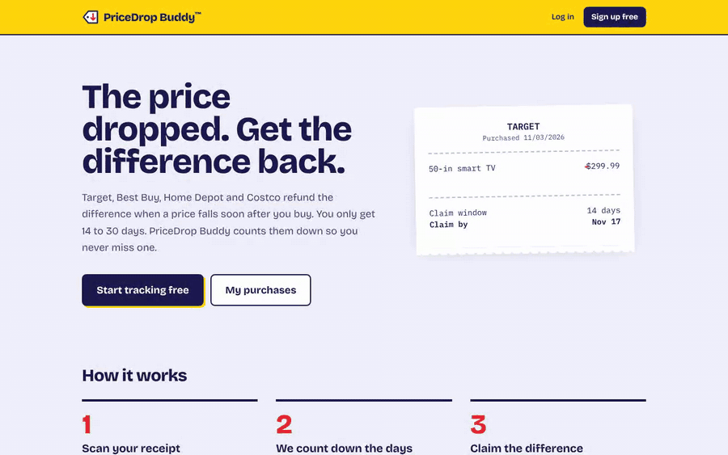
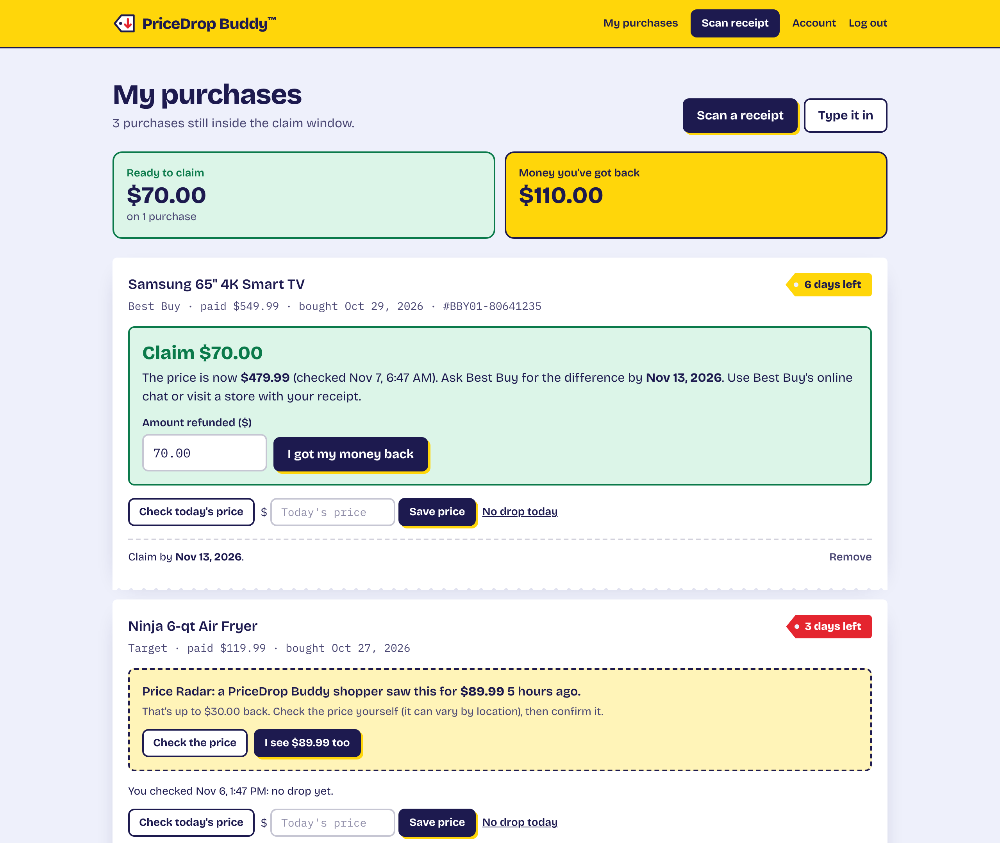
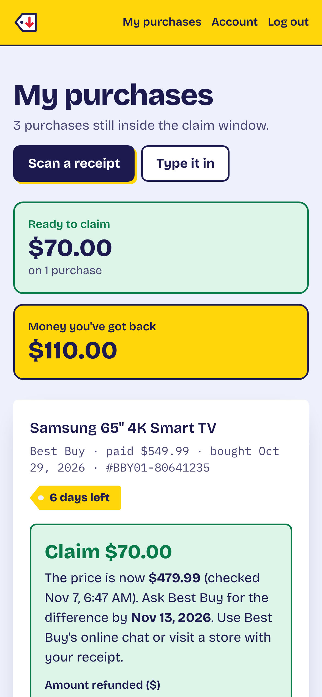
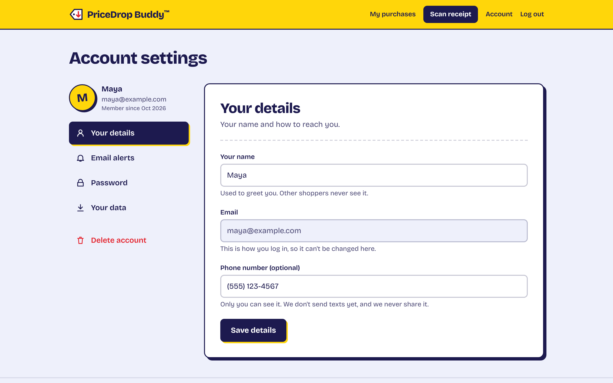
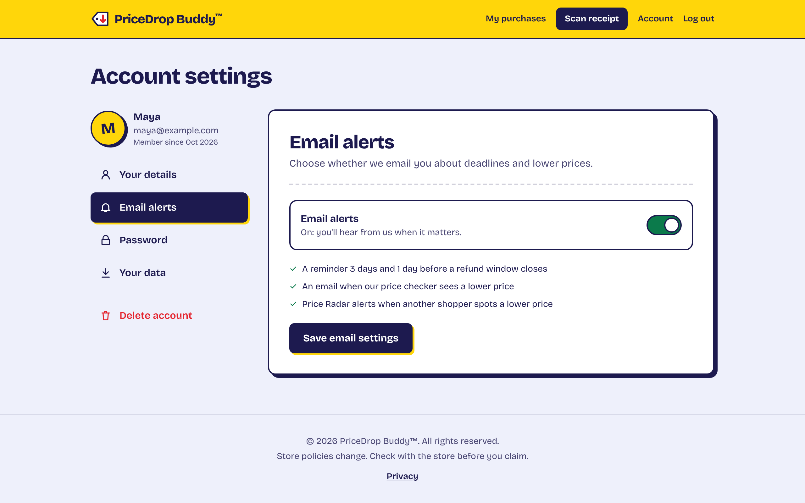
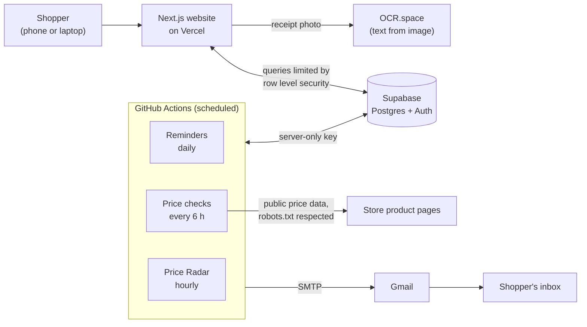

<div align="center">


# PriceDrop Buddy™

**Bought something and the price dropped? Get the difference back before the deadline.**

[**Try it live →**](https://pricedrop-buddy.vercel.app) &nbsp;·&nbsp; [How it works](#how-it-works) &nbsp;·&nbsp; [Engineering notes](#engineering-notes) &nbsp;·&nbsp; [Run it yourself](#run-it-yourself)

[](https://github.com/Sandhyal09/pricedrop-buddy/actions/workflows/ci.yml)




</div>

## The problem

Target, Best Buy, Home Depot and Costco will refund the difference if a price falls soon after you buy. But you only get **14 to 30 days**, every store has different rules, and nobody re-checks prices on things they already bought. The money is simply left on the table.

PriceDrop Buddy keeps the receipts, watches the prices, counts down every deadline and tells you exactly how to claim.

## What it does

| Feature | What it does |
| --- | --- |
| **Scan any receipt** | Photograph a paper receipt or upload an order confirmation. OCR plus a rule-based parser pulls out the store, date, order number and every item, then a review screen lets you fix anything before saving. Photos are never stored. |
| **Deadline countdown** | Each purchase gets its store's claim window, a days-left badge that turns red at 3 days, and store-specific steps to claim. |
| **Automatic price checks** | Every 6 hours a polite bot reads the price where stores allow it. A drop triggers an email: *"Claim $70 before Nov 13."* |
| **One-tap checks** | Where stores block bots, one button opens the product page; type the price you see and the app works out what you can claim. |
| **Community Price Radar** | When one shopper (or the bot) sees a lower price, everyone else who bought the same item and is still inside the window gets an alert. Anonymous, rate-limited, and always "check it yourself". |
| **Reminder emails** | One email per person, 3 days and 1 day before a window closes. Never sent twice. |
| **Money tracker** | Mark a claim as refunded and watch the total you've got back grow. |
| **Your account, your data** | Settings with a side menu, an email on/off switch, a plain-English [privacy page](https://pricedrop-buddy.vercel.app/privacy), "Download my data" and one-step account deletion. |

<table>
  <tr>
    <td width="66%"></td>
    <td width="34%"></td>
  </tr>
  <tr>
    <td></td>
    <td></td>
  </tr>
</table>

<sub>Screenshots use made-up sample data.</sub>

## How it works



- **Website** ([`src/app`](src/app)): server-rendered pages and Server Actions. Every database call runs as the logged-in user, so Postgres row level security decides what they can see.
- **Scheduled jobs** ([`scripts`](scripts), [`.github/workflows`](.github/workflows)): small TypeScript programs that run on GitHub's servers for free. They are the only code holding the database's secret key.
- **Database** ([`supabase/schema.sql`](supabase/schema.sql)): purchases, price history, shared price reports and profiles, each locked down with policies and explicit grants.

## Engineering notes

**I measured before I built.** The first plan was "check every store's price automatically". So I ran a probe from GitHub's servers against real product pages: Costco returned a price, Target served a robot check, Home Depot returned 403 and Best Buy timed out. Rather than scraping around those blocks, the bot only reads the standard machine-readable price (schema.org JSON-LD and meta tags), obeys `robots.txt`, identifies itself honestly, and backs off from blocked sites. The product then grew two features to cover the gap: one-tap checks and the crowd-powered Price Radar.

**Matching the same product across strangers.** Price Radar needs to know that two shoppers bought the same thing, from messy inputs. [`src/lib/item-key.ts`](src/lib/item-key.ts) turns product links and receipt SKUs into one stable key per store (Target TCIN, Best Buy SKU, Home Depot's 9-digit ID, Costco item number), and an SQL backfill applied the same rules to existing rows.

**Shared data, private people.** Price reports are readable by every user, but a column-level grant hides who reported them. Inserts must come from the logged-in user, are capped at 30 a day, and prices under 20% of what was paid are rejected as typos. Each alert remembers the price it announced, so nobody is emailed twice about the same drop.

**Security by default.** Row level security is on for every table and new tables aren't exposed automatically. The browser only ever holds the publishable key. Account deletion is a `security definer` function that can only delete `auth.uid()`, and purchases and price history cascade with it.

**Dates are harder than they look.** Claim windows are counted in calendar days in US Eastern time, with tests across month ends and the daylight-saving change.

**$0 to run.** Vercel, Supabase, GitHub Actions, OCR.space and Gmail are all used within their free tiers.

## Tests

```bash
npm test          # about 80 checks: deadlines, receipt parser, price reader, item keys, reminders, Radar matching
npm run lint
npm run typecheck
```

The [Checks workflow](.github/workflows/ci.yml) runs all of these plus a production build on every push.

## Project structure

```
src/app/            pages, Server Actions, account settings, privacy page
src/lib/            store rules, receipt parser, price reader, item keys
src/components/     header, forms, receipt scanner
scripts/            scheduled jobs: reminders, price checks, Price Radar
supabase/           full schema plus numbered updates
tests/              unit tests (npm test)
.github/workflows/  scheduled jobs and the Checks workflow
```

## Roadmap

- **Proof Pack:** a one-page PDF with the receipt line, today's price and the store's policy, ready to show at the counter.
- **Smarter receipt reading:** use an AI model to read receipts the rule-based parser misses.
- **Claim Success Board:** which stores actually paid out, and how fast.

## Supported stores

| Store | Days to claim a lower price |
| --- | --- |
| Best Buy | 15 |
| Target | 14 |
| Home Depot | 30 |
| Costco | 30 |
| Any other store | You enter it |

Store rules live in one file: [`src/lib/stores.ts`](src/lib/stores.ts). Policies change, so always check with the store before claiming.

## Run it yourself

Everything runs on free plans. The guide below assumes no prior experience.

<details>
<summary><strong>Step-by-step setup guide</strong></summary>

### 1. Connect the database

1. In Supabase, create a project (free plan) and wait about 2 minutes.
2. Open **SQL Editor → New query**, paste everything from [`supabase/schema.sql`](supabase/schema.sql), and click **Run**. You should see "Success."
3. Open **Project Settings → API** (or **API Keys**). You need two values:
   - **Project URL**
   - **Publishable key** (older projects call it the **anon public** key)

   Never use the **secret** or **service_role** key in this app.

### 2. Put it online with Vercel

1. In Vercel, click **Add New → Project** and import this repository.
2. Under **Environment Variables**, add:
   - `NEXT_PUBLIC_SUPABASE_URL` = your Project URL
   - `NEXT_PUBLIC_SUPABASE_PUBLISHABLE_KEY` = your publishable key
3. Click **Deploy**.
4. Back in Supabase, open **Authentication → URL Configuration** and set **Site URL** to your Vercel address (for example `https://pricedrop-buddy.vercel.app`). Add `https://YOUR-ADDRESS.vercel.app/auth/callback` under **Redirect URLs**. This makes the sign-up confirmation email link work.

### 3. Switch on receipt scanning

1. Get a free API key at [ocr.space](https://ocr.space/ocrapi/freekey) (25,000 scans a month, 1 MB per file).
2. In Vercel, open **Settings → Environment Variables** and add `OCR_SPACE_API_KEY` with your key. Don't add `NEXT_PUBLIC_` in front: this key must stay on the server.
3. Redeploy (Deployments → ⋯ → Redeploy).
4. In Supabase, run [`supabase/updates/002_add_sku.sql`](supabase/updates/002_add_sku.sql) in the SQL Editor once. It adds the item number (SKU) column.

How receipts are read: [OCR.space](https://ocr.space) turns the photo into text, then simple rules in [`src/lib/receipt-parser.ts`](src/lib/receipt-parser.ts) find the store, date, order number and item lines (name, SKU, price), skipping totals, taxes and payment lines.

### 4. Switch on reminder emails

Reminders run every morning on GitHub Actions ([`.github/workflows/reminders.yml`](.github/workflows/reminders.yml)) and send through Gmail.

1. In Supabase, run [`supabase/updates/003_reminders.sql`](supabase/updates/003_reminders.sql) and [`supabase/updates/004_reminder_access.sql`](supabase/updates/004_reminder_access.sql) once.
2. Turn on 2-Step Verification for the Gmail account, then create an **App password** at myaccount.google.com/apppasswords.
3. In GitHub, open **Settings → Secrets and variables → Actions** and add these repository secrets:
   - `SUPABASE_URL`: your Supabase Project URL
   - `SUPABASE_SECRET_KEY`: the **secret** key from Supabase → Project Settings → API Keys (never put this in Vercel or the code)
   - `GMAIL_USER`: the Gmail address that sends the emails
   - `GMAIL_APP_PASSWORD`: the 16-character app password
4. Test it: **Actions → Daily reminders → Run workflow** with "Dry run" ticked shows the emails in the log without sending. Untick it to send for real.

How it works: [`scripts/reminders-core.mts`](scripts/reminders-core.mts) picks purchases with 2–3 days left (first reminder) or 0–1 days left (last chance), groups them into one email per user, and [`scripts/send-reminders.mts`](scripts/send-reminders.mts) sends them and marks them as sent so nobody gets a reminder twice.

### 5. Switch on price checking

1. In Supabase, run [`supabase/updates/005_price_checks.sql`](supabase/updates/005_price_checks.sql) once.
2. It uses the same GitHub secrets as reminders. Test it: **Actions → Price checks → Run workflow** (dry run first).

What we found when testing from GitHub's servers (Nov 2026): Costco.com allowed it; Target showed a robot check, Home Depot returned 403, and Best Buy timed out. Run **Actions → Price check test** to test again.

### 6. Switch on Community Price Radar

Run [`supabase/updates/006_community_radar.sql`](supabase/updates/006_community_radar.sql) once. The hourly job ([`.github/workflows/radar.yml`](.github/workflows/radar.yml), logic in [`scripts/radar.mts`](scripts/radar.mts)) uses the same GitHub secrets. Items are matched by store and item number ([`src/lib/item-key.ts`](src/lib/item-key.ts)).

### 7. Switch on accounts and account deletion

Run [`supabase/updates/007_accounts.sql`](supabase/updates/007_accounts.sql) once. It adds the `profiles` table (filled in automatically for each new sign-up) and a `delete_my_account()` database function that can only delete the logged-in user. The last line should show `true`.

### 8. Run it on your own computer (optional)

```bash
npm install
cp .env.example .env.local   # then paste your values into .env.local
npm run dev                  # open http://localhost:3000
```
</details>

---

Built by [Sandhya](https://github.com/Sandhyal09). PriceDrop Buddy isn't affiliated with any store; store names belong to their owners.
